 

**A multi-agent crypto intelligence terminal for Android, wrapped in a cyber-interface.**

> **Showcase repository.** This page presents the product and the engineering behind it. The source code is private.

---

## `> what_it_does`

CryptoDept turns raw market noise into a clear verdict. A council of specialised AI agents reads price action, on-chain activity, news and sentiment, then produces one consensus signal you can act on, all inside a terminal-style interface.

| Module | What you get |
|---|---|
| **Asset Dossier** | Multi-tab brief per coin: live vitals, historical cycles, market depth across exchanges |
| **Analysis Node** | BUY / SELL / HOLD verdict, confidence meter, RSI, MACD, Fibonacci confluence, sentiment radar |
| **Quant Lab** | Four independent math engines (see below) |
| **Live Pulse** | Curated real-time news and social dominance shifts |
| **Widgets** | Auto-rotating 1x1 tracker and a 4x1 multi-coin "trading desk" carousel |
| **Cloud Sync** | Google sign-in syncs your watchlist across devices |

## `> quant_lab`

- **Cycle Scanner**: Fourier-transform analysis to surface hidden market cycles
- **Probability**: Monte Carlo simulation of potential price outcomes
- **Dynamism**: Hurst exponent and fractal-noise analysis to measure trend strength
- **Regression**: Standard decision lines to flag overextended price levels

## `> engineering`

| Area | Approach |
|---|---|
| UI | Jetpack Compose with a fully custom terminal theme, including a Matrix code-rain screensaver |
| Architecture | Clean layering (data / domain / presentation), Hilt dependency injection, coroutines |
| Agents | Pluggable analysis agents registered through DI, each producing an independent signal |
| Data | Retrofit + OkHttp against multiple market, on-chain and news providers |
| Storage | Room on top of SQLCipher, so local data is encrypted at rest |
| Backend | Firebase Auth, Remote Config, Cloud Functions, Messaging, Crashlytics, Performance |
| Integrity | Firebase App Check with Play Integrity |
| Monetisation | Google Play Billing with a Pro tier for the full AI council |
| Home screen | Jetpack Glance app widgets |

## `> design_language`

<table>
<tr>
<td bgcolor="#050505" width="120" align="center"><b>#FFB000</b> amber</td>
<td bgcolor="#050505" width="120" align="center"><b>#00FF41</b> matrix</td>
<td bgcolor="#050505" width="120" align="center"><b>#FF3B30</b> alert</td>
<td bgcolor="#050505" width="120" align="center"><b>#808080</b> ash</td>
</tr>
</table>

Monospace type, scan lines and amber-on-black contrast, built for glanceable reading under pressure.

---

Built by [@ivaylozhivkov88](https://github.com/ivaylozhivkov88) · Not financial advice

